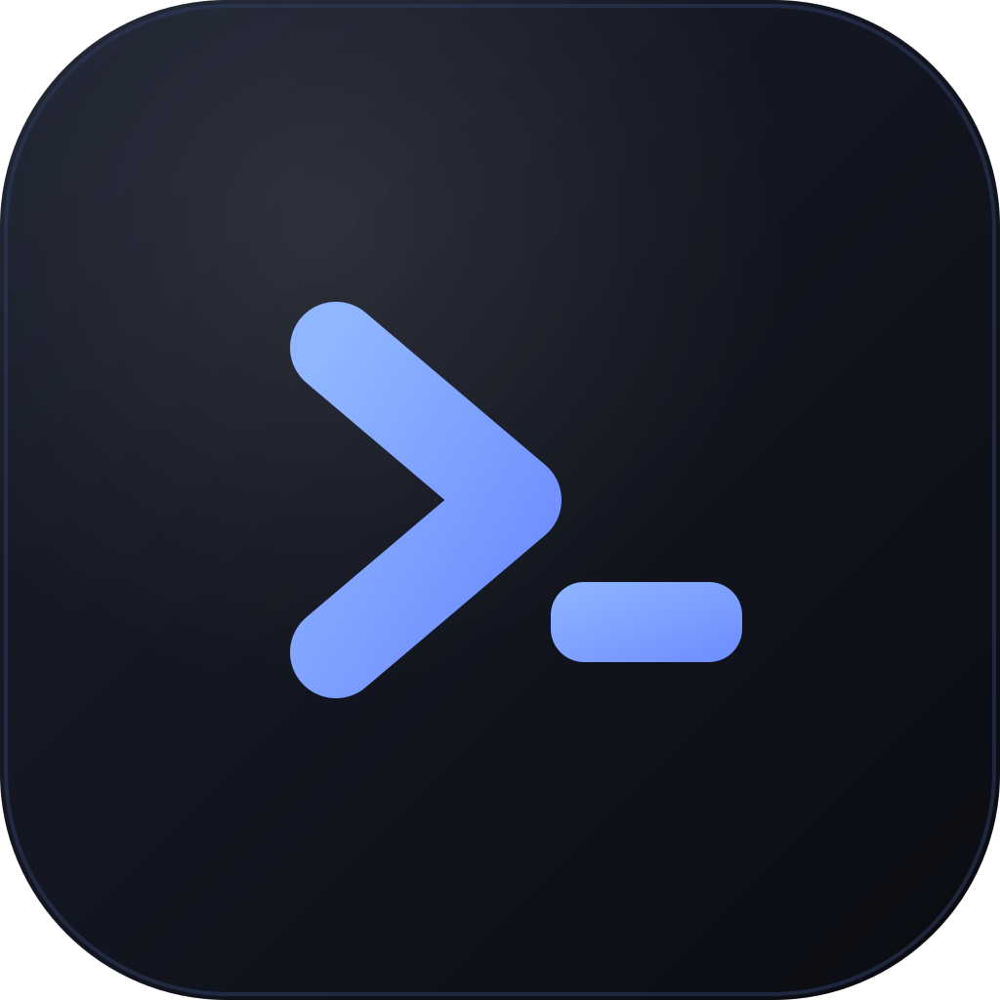

<p align="center"></p>

# CmdrZone — Project Command Center

[](https://github.com/Innoveramera/cmdrzone/actions/workflows/ci.yml)
[](LICENSE)

A macOS-first desktop "command center" for developers who juggle many projects and AI coding
agents. It replaces a messy wall of iTerm tabs with a single window: a live tree of every project
under a folder you choose (e.g. `~/Development`), and a per-project workspace with embedded
**Claude Code** (or other CLI agent) terminals, a code editor, git status, and more — designed so
you can never prompt the wrong project.

> Status: early but functional. Built in the open — issues and PRs welcome.

<!-- Add a screenshot at docs/screenshot.png -->


## Why

Running 5+ projects, each with its own Claude Code session in a separate terminal tab, gets messy
fast — wrong-tab prompts, no overview, lost sessions. CmdrZone gives you one place to see and
drive them all.

## Features

- **Project tree** from a root folder you pick — projects + monorepo sub-projects, with
  pinned/favorites, a stable per-project color, git dirty count, and live agent/session indicators.
  Double-click a project name to **rename its folder** on disk (confirmed; board + prefs follow).
- **Embedded agent terminals** — each installed agent (Claude Code / Aider / Codex / Gemini /
  opencode) has its own launch tab in every project. Run different agents side by side in real
  PTYs with your full login-shell PATH, with no project setting to change. Each agent button has a
  ▾ menu: start here, start in an isolated git worktree, or (Claude) resume the last conversation.
  Pick a **permission mode** per project (Supervised / Auto-accept edits / Plan / Full access) and
  every launch there gets the matching CLI flags.
- **Changes — see what the agent did** — a per-project diff tab: changed files with +/− counts and
  a Monaco side-by-side/unified diff, scoped to *uncommitted*, *since the agent started* or *after
  turn N*. Sessions are checkpointed into hidden git refs (untracked files included, your branch
  untouched), so you can also **revert to a checkpoint**.
- **Commit → push → PR in one click** — tick the files, let **Draft with Claude** write the commit
  message and PR text from the diff (headless `claude -p`, mirrors your repo's commit style), then
  Commit / Commit & push / Commit, push & PR (GitHub CLI). PR state shows as a badge on the branch.
- **Code editor** — a Files + **Monaco** (VS Code's editor) tab with multi-file tabs, IntelliSense,
  minimap, and save.
- **Board** — a per-project Trello-style Kanban (Ideas 💡 / Features ✨ / Bugs 🐞 / Tasks) with
  drag-and-drop cards and notes, persisted in SQLite — track what to build/fix per project.
  **Launch a Claude session straight from a card** (▶): its title/body seed the prompt (editable
  preview first), the session opens in the Terminals tab, and the card slides to "In Progress".
- **Agent CLI / MCP** — a `cmdrzone` CLI and an MCP server let AI agents create and manage board
  cards themselves (no GUI), straight against the SQLite store. See [Agent CLI / MCP](#agent-cli--mcp--let-agents-manage-the-board).
- **Project info** — README / AGENTS.md / CLAUDE.md / TASKS.md preview, `package.json` scripts as one-click run
  buttons, git status, dev-server **port detection** (open in browser), `.env` presence.
- **Agent awareness** — per-project status (working / waiting / done / error), an agent activity
  rail, and native notifications when an agent needs you or finishes.
- **A living dashboard** — the home hero hosts an ambient organism: one glowing nucleus per
  running agent (bright and spinning while it works, amber with an eye on you while it waits),
  twitching to Claude Code's hook events, folding into a sleeping, breathing core when nothing
  runs — plus a one-line voice that says what the agents are doing.
- **Keyboard-first** — `⌘K` fuzzy switcher, `⌃Tab` / `⌃⇧Tab` cycle through the projects with an
  agent running (also `⌘⌥→` / `⌘⌥←`), `⌘0` dashboard, `⌘1–9` pinned projects, `⌘T` new
  terminal, `⌘D` / `⌘⇧D` split pane.
- **Split terminals** — split any tab into panes (row/col); each pane is its own live PTY.
- **Themes, yours too** — Dark, Mono, Zone, Total Commander, plus **import any VS Code theme**
  (app + terminal ANSI palette + editor syntax) or create one from a canvas + accent color.
- **Model-agnostic, Claude-first** — agents are just launch recipes; add your own.

## Stack

Electron · electron-vite · React + TypeScript · node-pty + xterm.js · Monaco Editor ·
better-sqlite3 · pnpm workspace.

## Requirements

- macOS (Windows / Linux not yet supported)
- Node.js ≥ 20 and pnpm ≥ 10
- Xcode Command Line Tools (to compile the native modules)

## Download

Grab the latest **`CmdrZone-<version>-arm64.dmg`** from
[GitHub Releases](https://github.com/Innoveramera/cmdrzone/releases/latest), open it and drag
CmdrZone to Applications. Builds are for **Apple Silicon** Macs; on an Intel Mac, build from
source (below).

The app isn't signed with an Apple Developer ID yet, so macOS blocks the first launch ("damaged" or
"can't be opened"). Clear the download quarantine once and it starts normally from then on:

```bash
xattr -dr com.apple.quarantine /Applications/CmdrZone.app
```

Recommended extras:

- **tmux** (`brew install tmux`) gives you durable sessions: agents keep running when you quit
  the app and reattach on next launch. Without it, sessions end when CmdrZone closes; the
  `⛓` pill at the right end of the Terminals tab strip shows which mode you're in.
- **Claude Code** (or another agent CLI) on your login-shell `PATH`. CmdrZone detects installed
  agents by itself and gives each one a launch button in every project; there's nothing to
  configure.

CmdrZone checks for new versions in the background and opens the release page when one is out;
download it the same way (in-place updates need a signed build).

## Build from source

```bash
git clone https://github.com/Innoveramera/cmdrzone.git
cd cmdrzone
pnpm install          # installs deps + downloads Electron
pnpm rebuild:native   # IMPORTANT: rebuild node-pty + better-sqlite3 for Electron's ABI
pnpm dev              # launch with hot reload
```

> **Heads-up:** run `pnpm rebuild:native` after every `pnpm install`. pnpm 10 + Electron require the
> native modules (node-pty, better-sqlite3) compiled against Electron's ABI; this is wired in
> `scripts/rebuild-native.mjs`. If you hit a `NODE_MODULE_VERSION` mismatch, that's the fix.

Build / package:

```bash
pnpm build            # build main + preload + renderer
pnpm dist             # package a macOS DMG (ad-hoc signed by default)
```

For a distributable signed/notarized DMG, set your Apple Developer ID in
`apps/desktop/electron-builder.yml` and provide notarization credentials.

### Use it daily while developing

```bash
pnpm app:install   # build + copy CmdrZone.app to /Applications (re-run to update)
```

The installed app stores data in `~/Library/Application Support/CmdrZone`, **separate** from
`pnpm dev` — which runs as **"CmdrZone Dev"** with its own data store — so development never
disturbs your daily setup. First launch of the unsigned build: right-click → Open.

## Agent CLI / MCP — let agents manage the board

A CLI and an MCP server let AI agents (and you) create and manage **board cards** without the GUI —
e.g. a Claude session files a `bug`/`feature`/`task` card when it finishes a piece of work. Both
talk straight to the same SQLite store (`cmdrzone.db`) via the shared command core, and run under
`ELECTRON_RUN_AS_NODE` so they reuse the Electron-ABI `better-sqlite3` — no app needs to be running
and no extra native build is required. Changes appear in an open board when its window regains focus.

Build the tool bundles once (`pnpm build` emits `apps/desktop/out/{cli,mcp}.cjs`), then:

```bash
node bin/cmdrzone.mjs projects list
node bin/cmdrzone.mjs card add --project myapp --column Ideas --title "Add dark mode" --type feature
node bin/cmdrzone.mjs board show --project myapp --json
```

`--project` takes a project **name** or absolute **path**; `--column` a name or id. Global flags:
`--json`, `--db <path>`, and `--dev` (target the *CmdrZone Dev* data store instead of the installed
*CmdrZone*; or set `CMDRZONE_INSTANCE=dev` / `CMDRZONE_DB=<path>`). Run `node bin/cmdrzone.mjs --help`
for the full command list (`card add|update|move|rm`, `column add|rename|rm`).

**MCP** — point any MCP client (Claude Code/Desktop) at the launcher:

```jsonc
{ "mcpServers": { "cmdrzone": {
  "command": "node",
  "args": ["<repo>/bin/cmdrzone-mcp.mjs"],
  "env": { "CMDRZONE_INSTANCE": "daily" }   // or "dev"
}}}
```

Tools: `list_projects`, `get_board`, `create_card`, `update_card`, `move_card`, `delete_card`,
`create_column`, `rename_column`, `delete_column`.

## Architecture

```
apps/desktop/src/
  shared/    # framework-agnostic types + typed IPC contracts (no electron / node)
  core/      # domain logic: env (login-shell PATH), project scanner, agents, persistence, fs
  pty/       # node-pty session manager (runs in the PTY-host utilityProcess)
  main/      # electron main process + pty-host entry
  preload/   # contextBridge surface
  renderer/  # React UI (Zustand store, xterm, CodeMirror)
```

`core` / `pty` / `shared` import nothing from Electron, so they stay portable. See
[CONTRIBUTING.md](CONTRIBUTING.md) for dev details and headless smoke checks.

## Releases & updates

The app checks GitHub Releases for newer builds in the background and surfaces the result in the
sidebar footer (version label → **What's New**, plus a *Check for updates* action). The first time
a new version runs, **What's New** opens automatically, reading its notes from
[`CHANGELOG.md`](CHANGELOG.md) (one `## [version]` section per release).

Cutting a release:

1. Bump `version` in `apps/desktop/package.json` and add a `## [x.y.z]` section to `CHANGELOG.md`.
2. Push a matching tag: `git tag v0.1.0 && git push origin v0.1.0`.
3. `.github/workflows/release.yml` builds and publishes the GitHub Release (DMG + update zip +
   `latest-mac.yml`, the metadata the in-app updater reads).

**macOS in-place install requires signing.** Squirrel only swaps an app that's Developer ID-signed
+ notarized. Until that's set up (`mac.identity` in `electron-builder.yml` + notarization creds),
the updater runs in *notify* mode: it still detects new versions and opens the release page for a
manual download. Once signing is configured, run with `CMDRZONE_AUTO_INSTALL=1` (or flip
`AUTO_INSTALL` in `src/main/updater.ts`) to enable background download + **Restart to update**.

## Roadmap

- Vercel deploy status; richer dev-server detection
- Windows support

## Contributing

Issues and PRs welcome — see [CONTRIBUTING.md](CONTRIBUTING.md) and the
[Code of Conduct](CODE_OF_CONDUCT.md).

## License

[GPL-3.0-or-later](LICENSE) © Fredrik Hammarström
